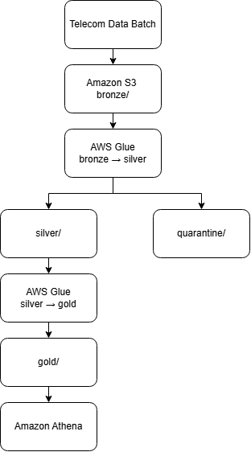
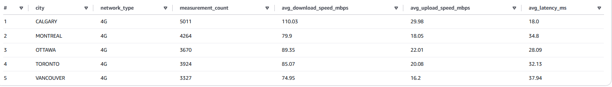
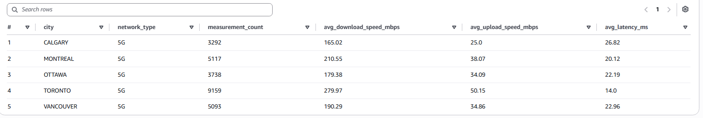

# Telecom Data Pipeline

**AWS Lambda | Amazon S3 | Amazon Athena | AWS Glue Data Catalog | Terraform | GitHub Actions**

A data pipeline for telecom network measurements from five Canadian cities, built with Python and AWS Glue. The project focuses on data transformation and preparing data for SQL analysis with Amazon Athena. Infrastructure is managed with Terraform, and testing and deployment are automated with GitHub Actions.

# Business Problem

A telecommunications company collects network measurements from several Canadian cities throughout the month. At the end of each month, the company sends the data for processing. The goal is to clean and validate the data and compare network performance between cities.

# My approach

To address this problem, I designed a data pipeline that uses multiple AWS services to process telecom network measurements. The infrastructure is managed with Terraform, while GitHub Actions automates testing and deployment. 

  

As shown in the diagram, several AWS services were used:
- As shown in the diagram, **Amazon S3** stores raw data in the bronze/ folder, cleaned data in silver/, processed data in gold/, and invalid records in quarantine/.
- **AWS Glue** uses two Python scripts to validate and clean the raw data, move valid records from Bronze to Silver, and transform the cleaned data from Silver to Gold.
- **Amazon Athena** is used to query the final data with SQL and compare network performance across Canadian cities.
- **Terraform** manages the AWS infrastructure, while GitHub Actions runs tests and automates deployment to AWS.

# Telecom Data
The pipeline uses simulated network measurements from five Canadian cities: Vancouver, Toronto, Montreal, Ottawa, and Calgary. I wrote a Python script to generate 50,000 records covering the last 30 days.

The data is not completely random. Each city and network type (4G or 5G) has its own speed and latency ranges, so the measurements follow different patterns. I also added realistic data quality issues to 8% of the records, such as missing values, duplicate IDs, invalid timestamps, and unusual measurements. This gives the pipeline data to clean and validate.

# Results

The results in Athena show differences in network performance across the five Canadian cities. 

First, here are the results for the 4G network:

  

- Download speed: Calgary has the fastest download speed at 110.03 Mbps, while Vancouver has the slowest at 74.95 Mbps.
- Upload speed: Calgary has the fastest upload speed at 29.98 Mbps, while Vancouver has the slowest at 16.20 Mbps.
- Latency: Calgary has the lowest latency at 18 ms, while Vancouver has the highest at 37.94 ms.

Next, here are the results for the 5G network:

  

- Download speed: Toronto has the highest speed (279.97 Mbps), while Calgary has the lowest (165.02 Mbps).
- Upload speed: Toronto has the highest speed (50.15 Mbps), while Calgary has the lowest (25.00 Mbps).
- Latency: Toronto has the lowest latency (14 ms), while Calgary has the highest (26.82 ms).

These results help the company compare network performance across cities and network types, identify areas with weaker performance, and determine where improvements may be needed.
