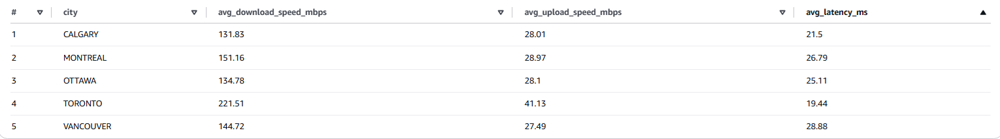

# Telecom Data Pipeline

**AWS Lambda | Amazon S3 | Amazon Athena | AWS Glue Data Catalog | Terraform | GitHub Actions**

A data pipeline for telecom network measurements using Python and AWS Glue. The project focuses on data transformation and preparing data for SQL analysis with Amazon Athena. Infrastructure is managed with Terraform, and testing and deployment are automated with GitHub Actions.

# Business Problem

A telecommunications company wants to automate the cleaning and transformation of network measurements to monitor performance across cities, compare results, and identify unusual measurements using SQL.

# My approach

To address this problem, I designed a data pipeline that uses multiple AWS services to process telecom network measurements. The infrastructure is managed with Terraform, while GitHub Actions automates testing and deployment. 

  

As shown in the diagram, several AWS services were used:
- Used Terraform to create and configure an Amazon S3 bucket for storing pipeline data and scripts.
- Raw telecom network measurements arrive in daily batches and are stored in the bronze/ directory in S3.
- AWS Glue runs a Python job to validate the raw data, remove duplicates, handle missing or invalid values, and separate invalid records into a quarantine location.
- Cleaned measurements are stored in the silver/ layer, while a second AWS Glue job processes them into aggregated datasets in the gold/ layer.
- The Gold datasets are intended to support analysis of network performance across cities using SQL and Amazon Athena.
- GitHub Actions runs tests and Terraform validation, then deploys infrastructure changes to AWS.

# Placeholder
IN PROGRESS

# Results

  

